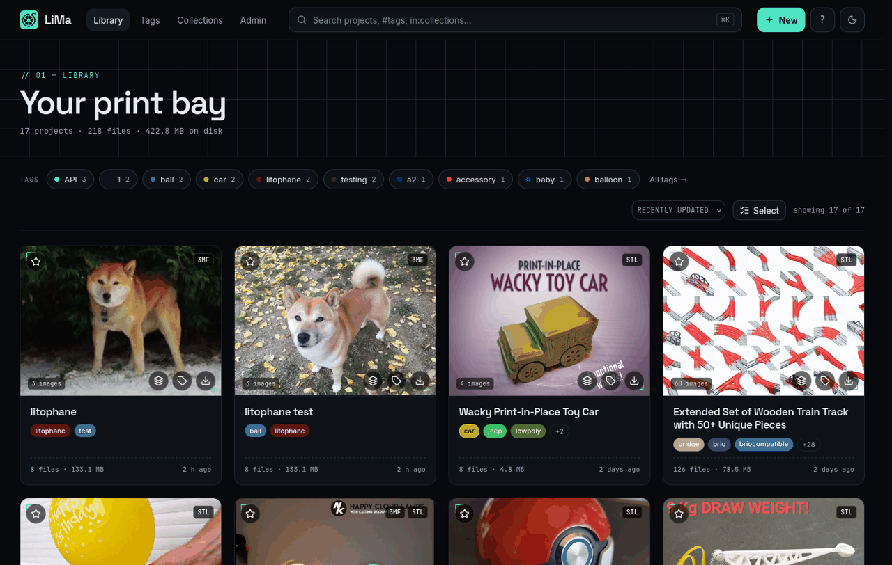

# LiMa: Library Index for Model Assets

LiMa is a self-hosted library for 3D models and the files around them.

Point it at folders you already have, or upload new models. LiMa indexes them and adds fast
search, tags, collections, previews and imports. Your files stay in normal folders on disk, and
LiMa never renames or changes them. Metadata lives in a separate SQLite database that you can
back up.

It is built for people who want a private, long-lived home for their models without the social
feed of Printables, Thingiverse or MakerWorld.



## What it does

- **Indexes folders you already have.** Drop a folder into the library and sync it. LiMa builds
  the project list from what is on disk and keeps it up to date.
- **Keeps your files untouched.** The filesystem is the source of truth. Names, tags,
  collections and covers live in the database, not inside your files.
- **Fast browsing and search.** Search by name, tag, collection, format, source and more.
  Filter the library and sort it by newest, name, size or file count.
- **Tags, collections and favourites.** Organise models the way you think about them.
- **Uploads that survive big files.** Drag and drop files or folders. Large uploads are
  resumable, and zip files can be extracted while keeping their folders.
- **3D previews and thumbnails.** STL, OBJ and 3MF models get a preview. Images and models are
  shown as cards, and models can be opened in Bambu Studio, OrcaSlicer or PrusaSlicer.
- **Imports.** Import single models or whole collections from Printables, MakerWorld and
  Thingiverse. Imported collections can stay in sync and pick up new models later.
- **Duplicate detection.** Find projects that contain the same models and merge the one you
  want to keep.
- **Trash and backups.** Deleted projects go to a trash folder first. Metadata can be backed up
  and restored from the Sync page.
- **API first.** A typed HTTP API with Swagger UI at `/docs` and the OpenAPI document at
  `/openapi.json`.

LiMa is still early in development. Keep your own backups and do not treat it as the only copy
of anything important.

## Run it with Docker

You need Docker with the Compose plugin.

```bash
git clone https://github.com/naxhh/LiMa.git
cd LiMa

mkdir -p data/library data/state
docker compose up -d --build
```

Open <http://localhost:6767>.

The included [`docker-compose.yml`](./docker-compose.yml) mounts two folders:

| Path | What it holds |
|------|---------------|
| `./data/library` | Your model library, one folder per project. LiMa reads and writes here. |
| `./data/state` | Database, thumbnails, staged uploads and metadata backups. |

Put existing model folders under `data/library/` before the first start, or use the UI to upload
new ones. To expose LiMa on another port, change `"6767:6767"` to `"8080:6767"`.

The compose file builds the image from the Dockerfile in this repository. If you already have an
image, replace `build: .` with your `image:` line.

## Configuration

All settings are environment variables. The defaults are fine for a first run.

| Variable | Default | Description |
|----------|---------|-------------|
| `LIMA_SERVER_PORT` | `6767` | Port the server listens on. |
| `LIMA_DATA_DIR` | `data` | Base folder for the library and state. |
| `LIMA_LIBRARY_DIR` | `$LIMA_DATA_DIR/library` | Model library, one folder per project. |
| `LIMA_STATE_DIR` | `$LIMA_DATA_DIR/state` | Database, uploads, thumbnails and backups. |
| `LIMA_DATABASE_URL` | `sqlite:$LIMA_STATE_DIR/lima.db?mode=rwc` | Database location. |
| `LIMA_UI_DIR` | `ui/dist` | Built web UI to serve at `/`. |
| `LIMA_UPLOAD_MAX_BYTES` | `21474836480` (20 GiB) | Largest accepted resumable upload. |
| `LIMA_WATCHER` | `true` | Watch the library and sync changes automatically. Set `false` to disable. |
| `LIMA_BACKUP_DIR` | `$LIMA_STATE_DIR/backups` | Where metadata backups are written. |
| `LIMA_BACKUP_INTERVAL_HOURS` | `24` | Hours between automatic backups. `0` disables them. |
| `LIMA_BACKUP_KEEP` | `7` | Number of backup files to keep. |
| `LIMA_TRASH_DAYS` | `30` | Days deleted projects stay in `<library>/.lima-trash/`. `0` makes deletes final. |
| `LIMA_COLLECTION_SYNC_HOURS` | `12` | Hours between checks of imported collections. `0` only syncs when you press Sync. |
| `LIMA_THINGIVERSE_TOKEN` | empty | Thingiverse app token, needed for Thingiverse imports. |

## Metadata backup and restore

Files on disk are the source of truth. Names, descriptions, covers, tags, collections and
favourites live only in the database, so LiMa writes a JSON backup to `LIMA_BACKUP_DIR` every
day.

The **Sync → Backups** page can back up now, download an export and restore. To recover after
losing the database: start LiMa, run a sync so the projects exist again, then restore the latest
backup. Projects are matched by folder; a folder renamed since the backup is matched by its
files' hashes.

Put the backup folder on a different disk than the database when possible.

## Development

Building, testing and running the UI and server from source is described in
[CONTRIBUTING.md](./CONTRIBUTING.md).

More documentation lives in [`docs/`](./docs/): the [API summary](./docs/API.md),
[backend brief](./docs/BRIEF.md), [frontend notes](./docs/FRONTEND.md) and
[slicer integration notes](./docs/SLICERS.md).
